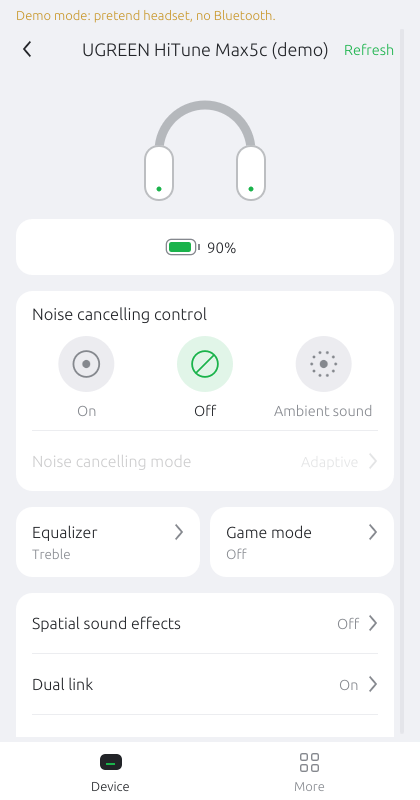

# ugreenapp-windows

An unofficial desktop app for the **UGREEN HiTune Max5c** headset, written in
Rust. It does what the UGREEN Connect phone app does for the everyday
settings — noise cancelling, equalizer, voice prompts — from a Windows or Linux
PC, with a small GUI and a command line.

This is a fork of [dustincorder/ugreenapp](https://github.com/dustincorder/ugreenapp),
which reverse-engineered the protocol and built the Linux CLI. This fork adds
Windows support and the GUI. See [Credits](#credits).

> Not affiliated with or endorsed by UGREEN. Use it at your own risk.

<p align="center">
  
</p>

## What it does

| | GUI | CLI |
|---|---|---|
| List paired headsets and connect | ✅ | ✅ |
| Firmware version and battery level | ✅ | ✅ |
| Noise cancelling: on, off, ambient sound; modes adaptive / gentle / general / ultra | ✅ | ✅ |
| Equalizer presets | ✅ | ✅ |
| Broadcast voice (prompt language) and prompt volume | ✅ | ✅ |
| Game mode, dual link (multipoint), spatial sound effects | ✅ | ✅ |
| Hi-Res audio decoding (LDAC) | shown, not changeable | ✅ (breaks the connection, see below) |
| Wear detection | only for models that have it | ✅ |
| Light, dark or system theme | ✅ | — |
| List the headset's RFCOMM services, dump raw bytes | — | ✅ |
| Factory reset | behind a confirmation | behind an explicit flag |

## Status

Tested on real hardware: **HiTune Max5c, firmware 0.5.7, on Windows**.

| Area | State |
|---|---|
| Windows: scan, info, firmware, noise control, EQ, prompt language and volume | Works on the headset above, from both the GUI and the CLI |
| Windows: error messages for Bluetooth off and headset off | Checked |
| Windows: game mode, multipoint, spatial audio | Work on the headset above, from the GUI |
| Windows: LDAC | The headset accepts the change, but the Bluetooth connection then breaks: no audio until the adapter is replugged and the headset paired again. **Disabled in the GUI** for now |
| Wear detection | The Max5c has no such sensor and stops answering when sent the command. **Disabled in the GUI** for it |
| Windows: factory reset | Present in the GUI and the CLI, **not tested** on hardware in this fork |
| Windows: SDP fallback when channel 1 is refused | Implemented, **never triggered** on the test headset |
| Linux | The original transport is kept as it was upstream. It still builds and the unit tests pass, but it was **not re-tested on hardware** in this fork |
| Other UGREEN models (Max5, Max6, H6 Pro, T6) | Known to the CLI catalog from upstream, **untested**. The GUI only accepts the Max5c |
| Equalizer preset names | Bass and treble were confirmed by ear; the other names come from the original mapping and are assumed correct |

## Download

Prebuilt Windows executables are on the
[Releases page](https://github.com/lucasrc97/ugreenapp-windows/releases):

- `ugreen-gui.exe` — the GUI
- `ugreen-cli.exe` — the command line

They are plain portable `.exe` files: no installer, nothing to configure.
They are not code-signed, so Windows may get in the way:

- **SmartScreen** may ask for confirmation the first time. Choose *More info*,
  then *Run anyway*.
- **Smart App Control** (Windows 11) may block them outright, with no option
  to continue, because they come from an unknown publisher. Started from WSL,
  a blocked executable fails with `Invalid argument`. The decision is made
  per file, so one build can be blocked and the next one allowed. The ways
  around it are to build from source, or to turn Smart App Control off in
  *Windows Security → App & browser control* (Windows does not let you turn
  it back on without reinstalling).

## Using the GUI

The screens follow the layout and the names of the UGREEN phone app.

1. Pair the headset in the Windows Bluetooth settings, as you would for audio.
   The app never pairs or discovers anything by itself.
2. Run `ugreen-gui.exe`. **My Devices** lists the paired devices; anything
   that is not a supported headset is greyed out.
3. Click the headset to connect.
4. Change what you want. After every change the app reads the headset again,
   so the window always shows what the headset actually stored.

A connected headset has two tabs:

- **Device**: battery, **Noise cancelling control** (On, Off, Ambient sound,
  and the **Noise cancelling mode**: Adaptive, Gentle, General, Ultra),
  **Equalizer**, **Game mode**, **Spatial sound effects**, **Dual link**
  (multipoint) and **Hi-Res audio decoding** (LDAC).
- **More**: device name, firmware version, **Broadcast voice** (language and
  prompt volume), **Theme** (System, Light, Dark), **Factory reset** and
  **Disconnect**.

Good to know:

- **Noise cancelling mode** can only be picked while noise cancelling is on.
- **Game mode** and **Dual link** cannot be switched on while Hi-Res audio
  decoding is on, because the headset refuses them.
- **Hi-Res audio decoding** is shown but cannot be changed: on Windows the
  change breaks the Bluetooth connection. Change it in the UGREEN phone app.
- **Wear detection** has no row for the Max5c, which has no such sensor.
- **Factory reset** asks for confirmation. Afterwards the app goes back to
  the device list, and the headset has to be paired again.
- **Prompt's volume** changes the spoken announcements, not the music.
- The phone app's **Control** tab (ANC button actions), the **Ringtone**
  broadcast voice and renaming the device are not available here.
- The **theme** and the window's size and position are remembered between
  runs. The gear at the top right of the device list opens the app's
  **Settings** (theme, debug console) without a headset.
- When something fails, the app shows a short plain message. The technical
  details, including the raw bytes exchanged with the headset, are in the
  **Debug console**: a separate window opened from Settings, from the More
  tab or with the *Details* link next to the message.
- After each command the controls pause for **one second**. Sending changes in
  very quick succession froze the test headset once, so the app paces them.
- If the headset is off or out of range, a command can take around 20 seconds
  to give up. The window stays responsive meanwhile and then shows the error.
- `ugreen-gui --demo` opens the app against a pretend headset. No Bluetooth
  needed — handy for looking around, or on a machine without the headset.

## Using the CLI

```text
ugreen-cli scan                 list supported paired headsets
ugreen-cli info                 battery, noise control, EQ, prompts
ugreen-cli fw                   firmware version
ugreen-cli anc off|transparency|light|medium|deep|adaptive
ugreen-cli eq classic|bass|treble|pop|rock|jazz|electronic|classical
ugreen-cli lang english|chinese
ugreen-cli vol 1..15            voice prompt volume
ugreen-cli services             RFCOMM channels the headset advertises (Windows)
```

- Run it with no command for an interactive prompt.
- `--json` prints the full state after a command.
- `--verbose` logs the raw bytes sent and received to stderr.
- `ugreen-cli --help` lists everything, including the less-tested toggles.

Each run of the CLI starts from scratch, so the summary printed right after a
`set` command only reflects the field you changed. Run `info` for the real
state of the headset.

`factory-reset` wipes the headset's settings. It refuses to run without
`--yes-really-reset-device`.

## Building from source

You need Rust 1.88 or newer (the project is developed with 1.91).

**Linux**

```bash
cargo build --release
./target/release/ugreen-gui
./target/release/ugreen-cli
```

The Linux build talks to BlueZ and uses `bluetoothctl` to find connected
devices.

**Windows, cross-compiled from Linux** with
[cargo-xwin](https://github.com/rust-cross/cargo-xwin) — no Visual Studio
required:

```bash
cargo install cargo-xwin
rustup target add x86_64-pc-windows-msvc
cargo xwin build --release --target x86_64-pc-windows-msvc
```

The executables land in `target/x86_64-pc-windows-msvc/release/`. Under WSL2
you can run them straight from the Linux shell; WSL itself has no access to
Bluetooth, so the Linux binaries cannot reach the headset from there.

**Checks**

```bash
cargo fmt --check
cargo clippy --all-targets -- -D warnings
cargo test
```

## Troubleshooting

| Message | Meaning |
|---|---|
| `Bluetooth is off or no Bluetooth adapter was found` | Turn Bluetooth on in Windows |
| `no supported UGREEN headset among the … device(s)` | The headset is not paired with this PC |
| `timed out connecting to …; is the headset on and in range?` | The headset is paired but off, out of range, or busy |

If something else goes wrong, run the same action with
`ugreen-cli --verbose` and look at the bytes exchanged.

## How it works

The headset exposes a Bluetooth serial port (RFCOMM channel 1, service name
`JL_SPP` — a JieLi chipset). Each command opens a connection, sends one
request, reads one response and closes.

```text
request   AA BB CC  cmd  len  data…             crc16 (MODBUS, little-endian)
response  DD EE FF  cmd  status  len  payload…  crc16 (CCITT-FALSE, little-endian)
```

On Windows the transport uses Winsock Bluetooth sockets (`AF_BTH` /
`BTHPROTO_RFCOMM`). It tries channel 1 first and, if that fails, asks the
headset over SDP which channel carries the Serial Port service. On Linux it
uses BlueZ RFCOMM sockets.

Code layout — a Cargo workspace under `crates/`:

| Crate | Contents |
|---|---|
| `ugreen-core` | Protocol encoding and decoding, the `Transport` trait, and one transport per OS |
| `ugreen-cli` | Command line and interactive prompt |
| `ugreen-gui` | The GUI ([egui / eframe](https://github.com/emilk/egui)). Bluetooth runs on a worker thread, so the window never blocks |

Background notes from the original project are in [`docs/`](docs/):
[protocol layer](docs/protocol-layer.md),
[earbuds desktop bridge](docs/earbuds-desktop-bridge.md),
[desktop app shape](docs/desktop-app-shape.md).

## Credits

All the hard part — working out the UGREEN protocol and building the first
working client — was done by the original project:

- **[dustincorder/ugreenapp](https://github.com/dustincorder/ugreenapp)** —
  the original Rust CLI for Linux and the protocol research this fork is
  built on.
- **[nx-d1frnt](https://github.com/nx-d1frnt)** — HiTune Max 5c support in the
  original repository (hardware switches and corrected EQ, ANC and voice
  prompt mappings).

This fork adds the Windows Bluetooth transport, the response checksum fix,
the workspace split and the GUI. As in the original project, the code was
written with AI assistance and then tested by hand on a real headset.

UGREEN and HiTune are trademarks of their owner. This project is independent
and is not affiliated with UGREEN.
